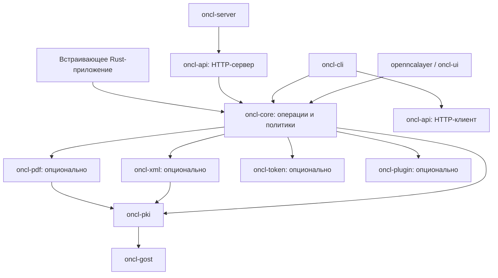

# OpenNCALayer как платформа: SDK, desktop, CLI и HTTP API

**Дата:** 2026-11-02.
**Статус:** дизайн и план утверждены пользователем 2026-11-02; реализация отдельно запущена пользователем. Это целевой дизайн, не отчёт о реализованном функционале.

> **2026-11-11 — изменение объёма по решению пользователя:** гарантированный размер документа теперь **1 ГиБ** (`1_073_741_824` байт), это заменяет 10 ГиБ. Гейт 10 ГиБ остановлен и является историей; бюджет памяти контрольного процесса остаётся 1 ГиБ. Документ больше 1 ГиБ отклоняется типизированным отказом InputLimit. Предел NCANode (около 30 МиБ JSON-строки, куча JVM 512 МБ) — ограничение оракула совместимости, а не наш контракт. Границы u64 выше 1 ГиБ остаются арифметическими пробами корректности, не гарантией.
**Связанные документы:** [исходный roadmap](roadmap.md), [плагины](plugins.md), [токены](tokens.md).
**План реализации:** [39 задач, зависимости и приёмка](../superpowers/plans/2026-11-02-platform.md); утверждён, включая WinGet. Выбран subagent-driven метод; 2026-11-03 отдельно разрешены локальные коммиты, параллельные worktree и локальная интеграция. Внешние публикации и push не разрешены.

Пользователь утвердил документ целиком, включая инженерные конкретизации. Пометка **«Инженерное предложение»** отличает авторскую конкретизацию от дословных решений интервью; после итогового согласования она также является частью утверждённого дизайна. Изменение продуктового кода и локальные коммиты разрешены отдельными командами пользователя; отправка изменений и публикации требуют нового разрешения.

## 1. Цель и дерево решений

OpenNCALayer становится недесктопной Rust-платформой для работы с ЭЦП Казахстана. Desktop — один из потребителей, не обязательный хозяин криптографии. Главный пользователь desktop — обычный человек; серверный режим отдельно предназначен для программных интеграций.

Дерево согласованных решений:

- **Общая реализация → четыре способа использования:** встраиваемый Rust SDK; desktop с совместимостью NCALayer и ручными инструментами; самостоятельный CLI с режимом HTTP-клиента; автономный HTTP-сервис.
- **Криптографические возможности → полная функциональная замена NCANode:** собственный контракт, без совместимости запросов/ответов NCANode; дополнительные хеширование, штампы времени, шифрование и разрешённые операции плагинов.
- **Большие данные → структурная обработка тоже обязательна:** XML/PDF наряду с байтовыми операциями; до 1 ГиБ на файл; контрольная операция в пределах 1 ГиБ RAM на 64-битной конфигурации; временные файлы разрешены.
- **Desktop → единый центр инструментов, структура А:** отдельное компактное окно запросов сайтов; пошаговая подпись; недавние и избранное без секретов; без межоперационного кеша разблокировки.
- **Безопасность → разные явные модели полномочий:** подтверждение в desktop; заранее выданные права в сервисе; отдельные токены клиентов; права на операции, ключи и плагины; новый HTTP API полностью выключен по умолчанию.
- **Эксплуатация → без постоянной очереди заданий и архива документов:** локальный аудит метаданных; отказ в применении закрытого ключа при недоступном обязательном аудите; опциональные OTLP-метрики и трассировки, не заменяющие аудит.
- **Поставка → один workspace и общий номер релиза SDK/приложений:** разные сборочные цели без GUI в CLI/сервисе; подготовленный SDK, но публикация в crates.io и публикации браузерных расширений отложены до отдельной команды.

Темы/скины, профили, корпоративный брендинг и управление организацией, универсальные формы настроек плагинов, парольное шифрование и универсальная интеграция PKCS#11/HSM не входят в эту работу.

## 2. Исходная точка и сохранение контрактов

Проект уже разделён на крейты. Проблема не в отсутствии workspace, а в пригодности модулей для независимого применения:

- `oncl-pki` содержит PKI, CMS, XMLDSig/XAdES, контейнеры ключей и сетевые проверки; `oncl-gost` — криптографические примитивы.
- `oncl-flows` не зависит от Slint, но описывает интерактивные сценарии страниц, выбор ключей, согласия на файлы/PIN и процессную очередь диалогов.
- `oncl-plugin` объединяет WASM-runtime, capabilities и хранение/доставку пакетов; использует flows и update.

- `openncalayer` включает `oncl-core/plugins` только для реестра ручного окна (`plugins/manual.rs`, из установленных пакетов `Store`); страницы и WSS по-прежнему идут через `PluginModules`. Замер MP7: `openncalayer.exe` (release, Windows) 47 979 520 → 48 040 448 байт (+60 928, +0,13 %); набор пакетов в дереве зависимостей не изменился.
- `openncalayer` непосредственно зависит от UI, desktop-интеграции и обновлений. Его библиотека объединяет WSS/IPC, установку, настройки, плагины, CLI и проверку CMS.
- Текущий XML-парсер принимает не более 64 МиБ и использует `roxmltree::Document`; существующий интерфейс обработки получает весь XML в `&[u8]`. Повышение одной константы не выполняет новую цель.
- Пользовательские настройки уже включают язык ru/kk/en/системный, автозапуск, прокси, обновления и экспериментальное включение токенов. Плагины уже имеют `settings_get/settings_put`.

Доказательства исходной структуры: `Cargo.toml`, `crates/openncalayer/Cargo.toml`, `crates/openncalayer/src/lib.rs`, `crates/oncl-flows/src/lib.rs`, `crates/oncl-pki/src/lib.rs`, `crates/oncl-pki/src/xmldsig/parse.rs`, `crates/oncl-desktop/src/settings.rs`, [контракт settings плагинов](plugins.md#settings).

Существующие сайты продолжают использовать протокол NCALayer, WSS/native messaging, установленные модули и зафиксированные отличия портов. Новый HTTP API не подменяет этот интерфейс. Его аутентификация не переносится автоматически на WSS. Новые лимиты больших файлов не расширяют автоматически старые протокольные лимиты.

**Инженерное предложение:** общий механизм проверок получает явную политику. Новые SDK/CLI/HTTP и ручные desktop-инструменты используют строгую политику по умолчанию. Адаптер NCALayer сохраняет существующую документированную семантику совместимости, в том числе согласованные условия применения ключей; это не скрытый fallback из строгого режима. Отчёт не называет непроведённую проверку успешной. Изменение существующего внешнего поведения требует отдельного явного решения, а не случайного изменения общего default.

## 3. Модули, интерфейсы и зависимости

### 3.1 Направление зависимостей

**Инженерное предложение:** один модуль операций является SDK, а не тонкий публичный SDK поверх второго идентичного движка.

Рабочие имена новых крейтов описывают структуру репозитория, не обещают доступность соответствующих имён в crates.io. Проверка имён/владения относится к подготовке отложенного внешнего выпуска.

| Модуль | Ответственность и изменение |
|---|---|
| `oncl-core`, новый | Публичный Rust SDK: типизированные операции, выбор формата, общие проверки/политики, работа с источниками ключей и данных, ресурсные бюджеты, структурированные результаты. Без UI, установщика, autostart и self-update. |
| `oncl-pki`, существующий | Контейнеры, сертификаты, CMS, PKIX, OCSP/CRL, TSP и общие PKI-механизмы; переход применимых путей на ограниченную память. Не содержит desktop-решений. |
| `oncl-xml`, новый | XMLDSig, XAdES, WS-Security, каноникализация и файловая обработка крупных XML. XML-реализация переносится из `oncl-pki`, а не дублируется. |
| `oncl-pdf`, новый | PDF/PAdES, ByteRange, incremental revisions, встроенные подписи, их проверка и достройка. Отдельная тяжёлая форматная зависимость, не обязательная для потребителя только CMS. |
| `oncl-gost`, существующий | Примитивы и необходимые стандартные алгоритмы; не знает об HTTP-запросах, окнах или пользовательских настройках. |
| `oncl-token`, существующий | Драйверы носителей и доступные операции устройства. Возможности подписи, расшифрования и согласования ключа не считаются взаимозаменяемыми. |
| `oncl-plugin` / `oncl-pdk`, существующие | Опциональное исполнение WASM и контракт host-capabilities. Runtime принимает явные адаптеры интерактивного/headless-контекста; не требует GUI и не зависит обратно от `oncl-core`. |
| `oncl-flows`, существующий | Интерактивные сценарии desktop и правила согласия для страниц; использует общие проверки, не содержит отдельную копию криптографии. Его очередь диалогов не сериализует серверные операции. |
| `oncl-api`, новый | Версионированный HTTP-контракт, OpenAPI, преобразование ошибок и потоковые ответы; клиентский и серверный адаптеры раздельными features. CLI-клиент не линкует серверный composition root. |
| `oncl-cli`, новый | Разбор аргументов, локальный вызов SDK либо HTTP-клиента, файловые/stdio-адаптеры, вывод и exit codes. |
| `oncl-server`, новый | Сборка HTTP-сервиса: конфигурация, аутентификация и права клиентов, ключевые провайдеры, аудит, лимиты, telemetry и жизненный цикл процесса. |
| `openncalayer`, `oncl-ui`, `oncl-desktop` | Сборка desktop, Slint, трей, системная интеграция, обновления и существующий интерфейс NCALayer; потребители общего движка. |

Не создаются отдельный крейт на каждый метод и дополнительные фасады, только передающие вызовы. Уже существующие подходящие модули переиспользуются. При переносе реализаций мигрируют все внутренние потребители, документация и проверки; старые модули/алиасы не сохраняются ради формального отсутствия изменений.

### 3.2 Контракт SDK

**Инженерное предложение:** публичный SDK предоставляет типизированные семейства операций, а не универсальную функцию, принимающую JSON NCALayer. На входе явно задаются источник данных, назначение результата, ключ/получатели, профиль операции, доверие и ресурсная политика. На выходе — результат и структурированный отчёт/ошибка.

- Есть последовательный источник с неизвестной заранее длиной и источник с произвольным доступом. Нужный для формата spool создаётся осознанно, не является незаметным полным буфером RAM.
- Хозяин приложения предоставляет транспорт PKI, секреты/провайдеры ключей, временное хранилище, отмену, прогресс и настройки доверия. SDK не читает настройки desktop как источник глобальной истины.
- Конструктор библиотеки не запускает демон, GUI, фоновое обновление, OTLP-экспорт, глобальный logger или собственный async runtime.
- Базовый потоковый контракт синхронный и пригоден для обычного файлового I/O. HTTP-адаптер изолирует блокирующую/CPU-работу ограниченным исполнителем, не блокирует сетевой event loop. Детали async-адаптации не меняют криптографическую семантику.
- Чистые криптографические проверки доступны независимо от сети; полная проверка доверия отдельно учитывает требуемые сетевые данные.
- Аппаратные токены, PDF/XML, плагины и OTLP не становятся безусловными зависимостями минимального сценария встраивания. Минимальная сборка проверяется отдельно от полной.
- Ошибки различают некорректный ввод, неподдерживаемый профиль/операцию, отсутствие прав, требуемое взаимодействие, недоступный секрет/носитель, ограничения ресурсов, отмену, сеть и внутреннюю ошибку. Человеческая строка не является машинным кодом ошибки.
- Потоковый sink может содержать незавершённый префикс при ошибке. Успех определяется финальным результатом, а не наличием выходных байтов; файловые адаптеры публикуют конечный файл только после успешного завершения.

## 4. Криптографическая функциональность

### 4.1 Зафиксированная цель NCANode

Эталон полноты — [OpenAPI NCANode на commit `0adab29a7d30c181d70e8cc6b4f243122f50c3b8`](https://github.com/ncanode-kz/NCANode/blob/0adab29a7d30c181d70e8cc6b4f243122f50c3b8/openapi.yml), не движущийся `master`. Имена его маршрутов ниже обозначают сравниваемые возможности, а не наши обязательные URL или совместимый wire-format.

| Семейство | Обязательные возможности |
|---|---|
| CMS / CAdES | Attached/detached; создание, несколько подписантов, добавление подписи, извлечение содержимого, проверка; B/T/LT/LTA; достройка существующей подписи до LT/LTA (`/cms/sign`, `/cms/sign/add`, `/cms/extract`, `/cms/verify`, `/cms/extend`). |
| XMLDSig / XAdES | Создание и проверка, несколько подписей и предусмотренное профилем добавление/замена; B/T/LT/LTA (`/xml/sign`, `/xml/verify`); каноникализация и ссылки являются частью корректности, а не косметикой сериализации. |
| WS-Security | Подпись и проверка SOAP/WSSE (`/wsse/sign`, `/wsse/verify`), с проверкой того, какой узел подписан и используется. |
| PDF / PAdES | Встроенная подпись PDF и проверка; B/T/LT/LTA, достройка (`/pdf/sign`, `/pdf/verify`, `/pdf/extend`); подпись PDF-байтов внешним CMS не заменяет эту строку. |
| JWS | Создание, добавление подписанта и проверка (`/jws/sign`, `/jws/sign/add`, `/jws/verify`); сериализации и detached-варианты фиксируются в матрице профилей эталона. |
| JWT | Создание, разбор и предусмотренная контрактом проверка (`/jwt/encode`, `/jwt/decode`). Разбор не называется проверкой; подпись и проверки claims различаются, алгоритм не выбирается безусловно по недоверенному заголовку. |
| X.509 / raw signature | Информация о сертификатах, подпись/проверка произвольных данных с отдельной подписью (`/x509/info`, `/x509/sign`, `/x509/verify`). Эти названия не означают выдачу сертификатов собственного CA. |
| PKCS#12 | Сведения о контейнере и сертификатах, перечисление aliases (`/pkcs12/info`, `/pkcs12/aliases`). Не дают клиенту права экспортировать закрытые ключи. |

Для каждого семейства требуется матрица профилей, алгоритмов, положительных/отрицательных примеров и независимой проверки. Наличие метода с названием `sign` или успешный round-trip только через наш собственный verifier не доказывают полноту. Допустимые ограничения безопасности и отличия описываются явно; отсутствие целого семейства не объявляется «полной заменой».

### 4.2 Дополнительные возможности

- Самостоятельные вычисление хешей, получение и проверка RFC 3161 штампов времени, просмотр/проверка сертификата, цепочки и статуса отзыва.
- Шифрование для одного/нескольких получателей по сертификатам и расшифрование соответствующим закрытым ключом. Стандартные CMS-профили; RSA и применимые казахстанские ГОСТ-профили обязательны, не только RSA.
- Контролируемый программный вызов поддерживаемых операций плагинов.
- Пакетная обработка применимых операций в SDK, desktop, CLI и API с отдельным результатом каждого элемента.

Криптографический фокус — ГОСТ-2004, ГОСТ-2015/512 и RSA для казахстанской ЭЦП, плюс явно настроенные CA при поддерживаемых алгоритмах. Это не обещание всех международных алгоритмов. Существующая проверка legacy RSA-SHA1 не превращается в разрешение создавать новые RSA-SHA1-подписи.

Алгоритм, назначение сертификата и возможности ключа/носителя проверяются для конкретной операции. Сертификат для подписи не становится пригодным для шифрования из-за совпадения имени владельца. Неподдерживаемый профиль не заменяется другим молча.

ГОСТ-шифрование требует доказанной комбинации OID, параметров, согласования/транспорта ключа, wrap и шифрования содержимого. [RFC 4490](https://www.rfc-editor.org/rfc/rfc4490) описывает старые ГОСТ/CMS-конвенции, [RFC 7836](https://www.rfc-editor.org/rfc/rfc7836) — сопутствующие алгоритмы, включая VKO/KDF/wrap. Они сами по себе не доказывают совместимость конкретного казахстанского профиля или кодировки. Выбор проверяемых стандартных профилей и получение независимых векторов — обязательная техническая часть реализации; выдумывать собственный контейнер или просто подставлять российские OID нельзя. Матрица не может состоять только из RSA со ссылкой на отсутствие готового ГОСТ-адаптера.

Модель целостности шифроконтейнера отражается честно. Простое расшифрование не выдаётся за подтверждение автора. Для аутентифицированных профилей выход не публикуется до проверки аутентичности; legacy-профили без аутентификации не объявляются аутентифицированными.

Генерация/экспорт/импорт закрытых ключей и управление их жизненным циклом не добавляются как новое семейство CLI/API. Уже существующие функции NCALayer для CSR/импорта сохраняются в прежней поверхности.

### 4.3 Проверка и доверие

Результат полной проверки имеет три состояния: `VALID`, `INVALID`, `INDETERMINATE`. Отчёт содержит раздельные результаты целостности, сертификата/цепочки, срока, отзыва, меток времени, применённой политики и основания времени проверки; для нескольких подписантов — по каждому.

Нет сети/свежих сведений об отзыве — не зелёный успех. Явная offline-проверка доступна, перечисляет непроведённые проверки и не меняет смысл `VALID`. При наличии достаточных проверенных вложенных данных offline-вывод определяется ими, а не только фактом отсутствия сети. Обязательная проверка перед подписью не пропускается из-за временной недоступности.

Недоверенный `signingTime` не равен доказанному времени. LT/LTA проверяются с учётом временных доказательств и допустимости алгоритмов, а не просто по текущему сроку конечного сертификата.

Присланный клиентом сертификат/цепочка может помогать построению пути, но не становится доверенным якорем. Дополнительные CA задаёт оператор/встраивающее приложение; HTTP-клиент не может расширить доверие запросом. Известные небезопасные XML-конструкции, внешние сущности и неоднозначные ссылки не разрешаются ради совместимости.

## 5. Большие документы и ресурсы

Обязательный контрольный профиль: **до 1 ГиБ входного файла**, включая содержательные XML и PDF, **до 1 ГиБ RAM** для одной активной операции в изолированном 64-битном контрольном процессе. Измеряется фактическая память процесса, а не только размер одного буфера. В отчёте фиксируются ОС, сборка, режим, файл, профиль, пик памяти, временный диск и длительность. Самостоятельный постоянный throughput-SLA не согласован.

Цель 1 ГиБ относится к исходному документу; выход может быть больше из-за упаковки/подписи и тоже учитывается квотой. Лимиты исходных данных, криптоконтейнера и транспортного framing различаются: верификатор/расшифровщик должен принимать допустимый результат обработки целевого документа, а не отклонять его из-за накладных байтов над 1 ГиБ. Эти надбавки ограничены отдельными бюджетами, не дают неограниченного входа. Результаты около/за 2 и 4 ГиБ проверяются отдельно от конечной цели 10 ГиБ. Контрольный профиль не означает доказанного отсутствия ограничений на остальных платформах или поддержки любого враждебного документа такого размера.

**Инженерное предложение:**

- SDK принимает потоки/файловые источники; CLI поддерживает файлы и stdin/stdout; HTTP — двоичные потоки/multipart. Для больших объектов не требуется цельная Base64-строка или JSON с целым документом.
- Потоковые CMS/hash/encryption-пути не создают полный буфер документа. DER/профили с необходимой известной длиной или повторным проходом могут использовать spool; формат не заменяется незаметно.
- XML: потоковый разбор и каноникализация там, где применимо, файловые индексы/повторные проходы для ссылок и поддерживаемых трансформаций. DOM всего документа и кэш полного канонизованного документа не являются решением. Поддержка не ограничивается искусственным XML с единственным огромным текстовым узлом.
- PDF: файловый/seekable-доступ к xref, объектам, ByteRange и incremental revisions; не переписывается весь PDF через полную модель в RAM. Приёмка включает object streams, revisions, существующие подписи и большое число объектов/страниц, а не только padding до нужной длины.
- Сохраняются ограничения глубины, сложности трансформаций, ссылок, распаковки объектов, метаданных и вычислительной работы. Их новая ресурсная модель должна принимать контрольные содержательные документы, а не оставить малый старый предел узлов при увеличенном пределе байтов.
- Размеры/offsets используют проверенную 64-битную арифметику; преобразования к `usize` проверяются. Memory mapping целого большого файла не выдаётся за выполнение RAM-предела без измерения фактической памяти.
- Лимиты входа, выхода, временного диска, памяти, длительности и числа активных операций задаются явно. Проверки применяются и при неизвестном `Content-Length`; поток обрывается при достижении лимита, а не после полного чтения.
- Глобальный бюджет сервера ограничивает конкуренцию; нехватка ресурсов даёт явный отказ/ограниченное ожидание, а не неограниченное накопление запросов. Нет общей блокировки из-за desktop-диалогов. Конкретный токен может требовать сериализации своих команд.
- Прогресс различает известную/неизвестную общую длину. Отмена проверяется между безопасными шагами; уже выполненное применение ключа не называется отменённым до выполнения.

Временные документы разрешены только в выделенном owner-only хранилище с квотами и ограниченным сроком жизни. Очистка знает собственные файлы, не обходит/не удаляет произвольные каталоги. После сбоя убираются только идентифицированные остатки этого хранилища. Ключевые контейнеры и пароли из запросов туда не выгружаются. ACL не равен шифрованию диска; гарантированное физическое стирание на SSD не обещается.

Для файлового результата используется временное назначение и финальное опубликование после успеха; исходник не перезаписывается неявно. Для большого HTTP-ответа/stdio контракт явно определяет финальный статус и незавершённый результат. Клиент не фиксирует частичный файл как успешный. Криптографическая подпись не является откатываемой транзакцией.

Ресурсные цели распространяются на новый SDK и встроенные инструменты. Legacy-плагины сохраняют свои контрактные лимиты, включая строковые/Base64-интерфейсы; превышение даёт конкретную ошибку. Наличие HTTP-обёртки не превращает их в потоковые плагины.

## 6. Desktop и пользовательские настройки

### 6.1 Согласованный визуальный и интерактивный подход

Пользователь принял структуру А и предметный макет трёх экранов: ручная подпись, подтверждение запроса сайта, отчёт с недостаточными данными. Это направление визуальной системы, не утверждение реализованного UI или неизменяемых текстов.

- Единый центр с боковой навигацией: обзор; подпись; проверка; шифрование/расшифрование; сертификаты; дополнительные инструменты (хеши, TSP, разрешённые плагины); управление плагинами; настройки.
- Центр открывается по запросу. Фоновая работа с сайтами не требует открытого главного окна и не открывает его при каждом запросе.
- Запрос сайта показывается отдельным компактным окном с постоянным доверенным контекстом. Сайт-инициатор, операция и существенные сведения не скрываются оформлением.
- Одна операция проходит в одном окне по шагам: источник ключа → разблокировка → сертификат и подтверждение → результат. Можно вернуться назад без повторного выбора того же файла; чувствительные значения не сохраняются после операции.
- В ручном сценарии выбор файлов/формата предшествует выбору ключа. До выполнения видны состав пакета, профиль, назначение выхода и последствия для исходников.
- Разблокировка не является согласием подписать. Итоговая кнопка называет действие: подписать, аутентифицироваться либо передать сведения, не общее «ОК» для разных смыслов.
- Пакет подтверждает конкретные элементы. Добавление/изменение состава или подмена содержимого после подтверждения требует новой проверки/согласия. При необходимости используется собственный snapshot/spool; выбранные байты связываются с реально обработанными.
- Полная идентичность/назначение выбранного сертификата, организация, срок и состояние проверок доступны до действия. Названия файлов от сайта помечаются недоверенными сведениями и не выдаются за понимание содержания.
- Отчёт проверки разделяет общий вывод и причины по проверкам/подписантам. Предупреждение об отсутствии данных визуально отличается от успеха и от доказанной недействительности.
- Ошибка рядом с проблемным полем/шагом, загрузка и отмена имеют явное состояние. Неподходящий сертификат не исчезает молча: причина понятна.

**Инженерное предложение:** сохраняются Slint и существующие renderer/platform-подходы; HTML служил только согласованию макета. Системный шрифт, читаемый базовый размер, последовательные отступы/иерархия, одна основная кнопка и семантические цвета. Нет переписывания desktop на WebView/Electron, декоративных эффектов или нового загрузчика тем.

### 6.2 Что запоминается и настраивается

Сохраняются действующие язык, автозапуск, прокси, обновления и экспериментальное включение токенов. Добавляются масштаб UI/текста, полная клавиатурная навигация, видимый фокус и корректная работа на разных DPI. Управление не зависит только от мыши, цвета, drag-and-drop или hover.

Недавние пути и избранные сертификаты — без закрытых ключей и паролей, с возможностью очистки. Путь/сертификат проверяется заново при использовании: запись не доказывает, что файл не изменился. Это не профили личности/организации.

Пароли и разблокированные программные ключи не кешируются между отдельными desktop-операциями и не пишутся на диск. Один явно подтверждённый пакет является одной операцией; это не разрешение подписывать последующие запросы сайта.

Новые настраиваемые категории трея/уведомлений, пользовательские/global hotkeys и напоминания об истечении сертификатов не выбраны и не добавляются. Уже существующее поведение не удаляется. Постоянный журнал desktop-действий по умолчанию выключен; существующие технические логи не превращаются в архив документов.

## 7. CLI и собственный HTTP API

### 7.1 CLI

Самостоятельный CLI работает без desktop и без сервера. Режим обращения к явно заданному HTTP endpoint — отдельный выбор, не скрытое условие любой операции.

**Инженерное предложение:** пакет `oncl-cli`, команда `oncl`; семейства команд соответствуют возможностям SDK. Синтаксис и примеры документируются до выпуска; существующий отдельный `openncalayer cms-verify` переводится в новый CLI с обновлением всех управляемых потребителей/документации, без вечного алиаса. Desktop-команды запуска/установки/TLS не перемещаются в SDK.

- Локальные файлы и stdin; выход в явно выбранный файл либо stdout. Для remote-режима путь входа является путём компьютера клиента: клиент передаёт байты, а не поручает серверу открыть такой путь.
- Читаемый вывод для человека и машинный JSON с кодами/структурированным отчётом. Прогресс/диагностика не загрязняют машинный stdout; бинарный stdout и JSON-отчёт не смешиваются.
- Интерактивный ввод секрета без echo; для автоматизации — защищённый файл/descriptor/явный внешний источник. Пароль/токен не передаётся обычным значением argv и не попадает в сообщение об ошибке.
- Пакет имеет отдельные результаты и финальный статус; уже успешные элементы не откатываются. По умолчанию независимые элементы продолжаются после ошибки элемента, но отмена/общая потеря обязательных ресурсов прекращает дальнейшую работу.
- Машинно различимы неверная подпись, неопределённая проверка, ошибка выполнения, частичный результат и отмена. Точная таблица exit codes — часть версионируемого CLI-контракта, а не повторение любых текущих внутренних кодов daemon.

### 7.2 HTTP

Собственный документированный OpenAPI-контракт; HTTP/JSON для небольших управляющих сообщений и бинарные/multipart-потоки для больших данных. Совместимые маршруты NCANode не вводятся.

**Инженерное предложение:** версия контракта в `/v1`; типизированные JSON DTO и единая структура ошибки со стабильным `code` и идентификатором операции. HTTP-коды описывают транспорт/доступ/исполнение; завершённый отчёт с `INVALID` не превращается в безымянную внутреннюю ошибку. JSON-обёртка не заставляет кодировать все большие документы в Base64.

- API полностью выключен по умолчанию: ни loopback, ни сетевой порт не открывается установкой, desktop-запуском или созданием SDK. Явный запуск/включение сервиса — действие оператора.
- При включении безопасный адрес по умолчанию — loopback. Внутренняя сеть разрешается явно. Прямой публичный интернет не является согласованным стандартным сценарием развёртывания.
- Индивидуальные отзываемые API-токены и права на операции, идентификаторы ключей и операции плагинов. Один общий пароль и анонимная подпись не применяются. mTLS не выбран как дополнительный обязательный механизм.
- Защищённый транспорт для сетевого доступа: TLS в сервисе либо явно настроенный доверенный reverse proxy. Нельзя доверять произвольному `Forwarded`/`X-Forwarded-*` или считать loopback аутентификацией.
- Клиент не получает произвольные server-side пути, URL-fetch документов, управление доверием CA, чтение ключей или административные действия через обычный запрос подписи. Допустимые исходящие обращения плагинов/PKI остаются отдельными ограниченными capabilities.
- Разрешение проверяется до применения ключа и до вызова плагина; реальная выполняемая операция не может отличаться от разрешённой из-за другого method/module во вложенном payload.
- Запросы выполняются в рамках соединения/вызова. Нет job ID для последующего опроса, постоянного планировщика, БД заданий, восстановления после рестарта и обещания exactly-once.
- Для прогресса и пакетных больших результатов контракт предусматривает потоковые multipart-части: управляющие JSON-события, выходные данные и явный завершающий результат элемента/вызова. Отсутствующий финал означает незавершённый/неизвестный исход, не успех. HTTP-заголовок сам по себе не подтверждает успех криптооперации.
- Обрыв соединения инициирует отмену дальнейшей работы и очистку собственных временных данных. Уже созданная подпись/команда токена не отменяются задним числом. Автоматическое повторение потенциально выполненной операции не добавляется.

## 8. Ключи, headless-плагины и секреты

### 8.1 Разделение полномочий

В desktop пользователь подтверждает конкретное действие. В headless-сервисе полномочия заранее выдаёт оператор; окна не открываются и автоматическое «Да» вместо пользователя не подставляется. Запуск локальной CLI-команды — явное намерение оператора в рамках переданных параметров; GUI-подтверждение не становится обязательной зависимостью CI.

Сервис не наследует ключи, согласия, недавние файлы, settings и каталоги desktop. Встраивающий SDK хозяин сам контролирует предоставленные библиотеке ключи и права; библиотека не является защитой от привилегированного кода хозяина.

### 8.2 Источники ключей

- Файловые PKCS#12/JKS и поддерживаемые наши аппаратные токены; JKS не получает новую запись/экспорт как неявное расширение.
- Основной сервисный сценарий — подключённый оператором ключ, доступный клиенту по разрешённому непрозрачному идентификатору.
- Дополнительно, только по явной настройке, защищённый контейнер и секрет могут передаваться в запросе. Секретные поля имеют малые отдельные лимиты; большой поток документов не позволяет загрузить неограниченный контейнер ключей.
- Секреты подключённых ключей поступают извне: owner-only файлы/secret mounts или защищённый канал при запуске. Обычный конфиг хранит ссылки, не пароли. Собственный менеджер секретов и дополнительная интеграция системных vault не входят в выбранный объём.
- Разблокированный ключ может жить в памяти явно запущенного сервиса. После рестарта секрет подаётся заново. Доступ по API-токену не позволяет получить контейнер/секрет обратно.
- Ключи не экспортируются из аппаратного носителя. Нельзя обещать расшифрование носителем, у которого реализована только подпись. Возможности проверяются явно, неподдерживаемая операция отклоняется.
- Существующий экспериментальный статус аппаратных драйверов и отсутствие аппаратного подтверждения не маскируются. Эмуляторная проверка не выдаётся за проверку на реальном устройстве.

### 8.3 Плагины

Установленный плагин не становится автоматически доступным через HTTP/CLI. Разрешаются конкретные плагины и операции; ключи и файловые/сетевые capabilities ограничиваются контекстом вызова.

Desktop- и сервисный вызывающие различаются. Сервисный клиент не выдаётся за посещение доверенного сайта, а Origin не берётся из произвольного поля payload как доказательство происхождения. Для headless-совместимой операции необходимые ключи/данные задаются явно. Если остаётся обязательный интерактивный шаг, возвращается `interaction_required`, а не выдуманный ответ пользователя. Операции, требующие браузерной сессии, не объявляются универсально headless-совместимыми.

Сохраняются существующие `settings_get/settings_put`, capability-проверки и ограничения пакетов. Новый конструктор настроек/экранов плагинов и произвольный UI-код не добавляются. Опциональный runtime не должен тянуть desktop, загрузчик каталогов или автообновление в минимальный SDK без явного выбора соответствующей функции.

## 9. Данные, аудит и наблюдаемость

### 9.1 Хранение и аудит

Нет постоянного архива документов, содержимого запросов, контейнеров ключей, паролей или результатов ради истории. Результат возвращается клиенту либо сохраняется в явно выбранное назначение. Временные данные подчиняются разделу 5, а не становятся неявным архивом.

Сервис ведёт локальный аудит метаданных с настраиваемыми ротацией, сроком хранения и квотой: кто вызвал, какая операция, разрешённый идентификатор ключа, время и итог. Не записываются содержимое/имена документов, секреты или необработанные request/response bodies. Привязка сертификата к человеку не экспортируется в telemetry.

До применения закрытого ключа сервис должен успешно записать обязательную запись аудита. При недоступном аудите новые подпись/расшифрование и другие применения закрытого ключа не выполняются. OTLP не является подтверждением записи аудита.

**Инженерное предложение:** регистрируются начало и финальный исход с одним идентификатором операции, для пакета — также элементы. Если ошибка аудита произошла после фактического применения ключа, действие нельзя объявить несуществовавшим: наружу возвращается корректный неопределённый/ошибочный исход, сервис блокирует дальнейшие применения ключей до восстановления аудита. Потеря ответа не означает, что ключ не применялся. Непрерывный доказуемо неизменяемый журнал или гарантия неотказуемости не заявляются.

### 9.2 OTLP

Опциональные OTLP-метрики и трассировки сервера, **выключены по умолчанию**. Collector и параметры экспорта задаёт оператор. OTLP-логи не выбраны; локальные технические логи и аудит остаются отдельными механизмами.

Разрешённые безопасные атрибуты: семейство операции/формата, класс результата, длительности, размеры, классы PKI-сетевых сбоев, занятость и потребление ресурсов. Нет документов, паролей, API-токенов, ключевого материала, ИИН/БИН, полных путей, raw headers/payloads и необработанных текстов ошибок. Метрики не размечаются высококардинальными значениями идентификаторов запросов/ключей/клиентов; трассировка не используется как обход запрета на персональные данные.

Семплирование трассировок допустимо и не влияет на полноту локального обязательного аудита. Недоступный collector не блокирует операции: буферы/очереди экспорта ограничены, отказ доставки наблюдаем и не расходует неограниченную память. SDK не устанавливает глобальный subscriber/exporter; хозяин решает, подключать ли его. Desktop не начинает отправлять telemetry из-за появления серверной функции.

## 10. Поставка, совместимость и отложенные действия

- Один репозиторий/workspace, общая версия SDK и приложений. Это не перевод плагинов на общий жизненный цикл версии.
- Desktop остаётся самостоятельным дистрибутивом со своей интеграцией. CLI и сервер имеют отдельные лёгкие сборочные цели и устанавливаются без GUI/оконной системы.
- **Инженерное предложение:** первичная серверная эксплуатация — standalone-процесс/служба и контейнер; контейнер получает конфигурацию/секреты/временную папку явно, не включает desktop-autostart и не монтирует домашний каталог пользователя целиком. Обновление серверной поставки управляет оператор, desktop self-update туда не переносится.
- Существующая desktop-матрица, включая Win7 x86/x64, не отменяется. Новый контроль 1 ГиБ/1 ГиБ проводится на 64-битной конфигурации; проверка импорта/старых ОС остаётся обязательной для их desktop-сборок. Новые зависимости не могут молча убрать старый target.
- Rust SDK имеет поддерживаемый документированный интерфейс, примеры встраивания, описанные ошибки, политику безопасности и semver-правила. В pre-1.0 несовместимости требуют соответствующей версии и миграционных указаний; внутренние модули не объявляются все стабильными публичными контрактами.
- SDK и нужная транзитивная цепочка пакетов готовятся к публикации, с проверкой лицензий, содержимого пакетов и воспроизводимой сборки. Пока публикация отложена, примеры честно используют git/path, не предлагают установить ещё не выпущенную registry-версию.
- Фактические upload в crates.io и публикации браузерных расширений — отдельная команда пользователя. Ни создание дизайна, ни реализация SDK не запускают их автоматически. Публикации плагинов этим решением не переопределяются.
- Это не ребрендинг продукта, не разнос в независимые репозитории и не основание переписывать действующий механизм обновлений.

### 10.1 Установка desktop через WinGet

**Дополнение интервью 2026-11-02, утверждено пользователем:** основной пакет WinGet содержит только stable-версии desktop. Первый публичный PR в `microsoft/winget-pkgs` отправляется только по отдельной команде после проверок. Штатное подписанное самообновление OpenNCALayer сохраняется по пользовательской настройке; WinGet также позволяет явно обновить установленную копию.

**Инженерная конкретизация:** предлагаемый `PackageIdentifier` — `arynyklas.OpenNCALayer`; перед подачей проверяются уникальность и правильное publisher/ARP-сопоставление. Используются опубликованные version-specific HTTPS release assets для Windows x64/x86, собственные installer SHA-256 и per-user scope. WinGet требует Windows 10 1809+; Win7 не заявляется как WinGet-target и сохраняет обычные установщики. Отдельные WinGet-пакеты SDK/CLI/сервера и Preview-канал в это дополнение не входят.

Нужны multi-file manifest и реальная проверка install/upgrade/reinstall/uninstall в чистой Windows VM/Sandbox. Имя, publisher, DisplayVersion и uninstall identity берутся из фактической регистрации установленного приложения; по одному tag name нельзя обещать корректный upgrade. Самообновлённая копия распознаётся без повторного downgrade/upgrade loop. Для self-updating пакета используется поддерживаемое явное обновление WinGet, не отключение нашего updater.

У закреплённого Velopack `8d2844f324a69bd848719ef465b1ae12c5060524` Setup поддерживает `--silent`, но путь переустановки принудительно останавливает пакет. WinGet-вход установки/обновления обязан сначала получить локальный maintenance/drain lease приложения: завершить активные операции, запретить новые на время замены и вернуть явную ошибку при невозможности безопасного ожидания. Проверка «один раз посмотреть idle» без удержания lease не достаточна. Принудительное завершение активной подписи или подстановка несуществующего `--nolaunch` не являются решением. Конкретный первый-party installer adapter входит в план поставки; GUI, CA trust и согласия на криптооперации не подтверждаются автоматически.

До приёма манифеста Microsoft и появления пакета в публичном source команда `winget install --id arynyklas.OpenNCALayer --exact` является целевым пользовательским сценарием, не уже доступной функцией. Локальная валидация YAML и `install --manifest` не доказывают каталогную доступность. Первая публикация stable и её внешнее принятие являются явными предпосылками этого последнего гейта, не поводом выдавать alpha за stable.

Основания: [манифесты](https://learn.microsoft.com/en-us/windows/package-manager/package/manifest), [процедура подачи](https://learn.microsoft.com/en-us/windows/package-manager/package/repository), [поддерживаемые Windows](https://learn.microsoft.com/en-us/windows/package-manager/winget/), [закреплённый Setup](https://github.com/velopack/velopack/blob/8d2844f324a69bd848719ef465b1ae12c5060524/src/bins/src/setup.rs), [путь установки](https://github.com/velopack/velopack/blob/8d2844f324a69bd848719ef465b1ae12c5060524/src/bins/src/commands/install.rs).

## 11. Приёмка полного результата

Этот раздел задаёт будущие доказательства реализации. Он **не утверждает**, что перечисленные прогоны выполнены в сессии дизайна.

| Область | Наблюдаемое доказательство |
|---|---|
| Независимое встраивание | Отдельный Rust-потребитель собирается и выполняет подпись/проверку через SDK без daemon, UI, display session и серверного порта; минимальная dependency closure не содержит Slint/desktop/updater. |
| Раздельные приложения | CLI исполняет локальную операцию без фонового процесса; тот же сценарий через явно запущенный HTTP-сервис имеет одинаковую криптографическую семантику/отчёт; server работает без GUI. |
| Полнота функций | Все строки раздела 4.1 сопоставлены с pinned-эталоном и подтверждены содержательными положительными/отрицательными случаями. Подпись и проверка сверены с независимыми реализациями/стандартными векторами, не только друг с другом. |
| Новые операции | Отдельно проверены хеши, TSP, RSA- и применимые казахстанские ГОСТ-CMS-профили шифрования, несколько получателей, неверный ключ/назначение, повреждения и ограничения носителя. |
| Большие данные | Через SDK, CLI и HTTP выполняются заявленные операции на содержательных файлах до 1 ГиБ, включая XML/PDF; проверены границы размера (1 ГиБ принят, 1 ГиБ + 1 байт отклонён), неизвестная длина входа, вход/выход выше лимита, память и временный диск. Нет заявления о готовности на основании одного разреженного/padding-файла. |
| Память и конкуренция | В фиксированном 64-битном профиле одна операция укладывается в 1 ГиБ RAM; параллельные запросы ограничиваются общим бюджетом; отмена/квота/диск full не приводят к OOM, повреждённому успешному результату или утечке временных файлов. |
| Проверка доверия | Различаются VALID/INVALID/INDETERMINATE, offline и missing revocation, повреждённая подпись, неверная цепочка/CA, сроки и временные доказательства; добавленная клиентом цепочка не расширяет доверие. |
| Авторизация | По умолчанию новый порт закрыт; явно включённый API требует токен и права. Проверены отозванный токен, чужой ключ/операция/плагин, подмена вложенного метода, недоверенные proxy headers/Origin и отсутствие доступа к server-side путям. |
| Секреты и аудит | Реальный вызов не оставляет секреты в конфиге, логах, аудите или spool; документы допускаются только в ограниченном временном хранилище, не в журналах/постоянном архиве. Недоступный обязательный аудит не позволяет начать применение ключа; сбой после применения не превращается в ложное «не выполнено». |
| Headless-плагины | Разрешённая совместимая операция работает без окна; обязательное взаимодействие даёт явную ошибку, а не автоответ; старый лимит остаётся честным; установленный неразрешённый плагин по API не вызывается. |
| Desktop | На реальной Slint-поверхности пройдены ручная операция, запрос сайта, назад/отмена, ошибочный пароль/PIN, неподходящий сертификат, пакет, ошибки сети и итог проверки; UI соответствует принятой структуре и визуальной системе, работает с клавиатурой/DPI. Макет в браузере этого не доказывает. |
| Совместимость NCALayer | Существующие conformance/smoke сохраняются; намеренные изменения контрактов/CLI мигрированы целиком. Большой HTTP API не изменяет границы WSS или согласия страниц. |
| OTLP | Тестовый collector получает разрешённые метрики/spans от реального вызова; проверено отсутствие запрещённых данных, выключенное состояние по умолчанию и ограниченные ресурсы при недоступном collector. |
| Поставка | Проверены отдельные пакетные dependency closure, SDK-примеры, упаковка и существующие платформенные гейты; внешние публикации не выполнялись без отдельной команды. |
| WinGet | Манифест stable проходит валидацию; реальные install/upgrade/reinstall/uninstall x64/x86 работают per-user, не обрывают активную подпись при upgrade, не подтверждают CA trust и не теряют пользовательские данные. Штатный updater и обнаружение установленной версии согласованы. После отдельно разрешённой подачи и приёма проверена установка из публичного source; до этого внешний гейт отмечен ожидающим, не пройденным. |

Тесты закрепляют наблюдаемое поведение, границы, переходы, семантику ошибок и недопустимые утечки; не текст исходников, случайную формулировку и не пересылку аргументов в mock. Большие сценарии допускают отдельный воспроизводимый ресурсный стенд, но являются обязательным приёмочным гейтом полного результата, а не необязательным обещанием.

## 12. Инженерная свобода и неизменяемый объём

После утверждения разработчик выбирает конкретные parser/crypto/HTTP-библиотеки, внутренние структуры, точные сигнатуры типизированного SDK, механизмы файлового индексирования и лимиты сложности на основе измерений и стандартов. Эти решения не требуют нового продуктового интервью, пока сохраняются договорённые возможности, безопасность, ресурсы и платформы.

Изменение цели 1 ГиБ/1 ГиБ, исключение XML/PDF/ГОСТ-шифрования, замена PAdES внешним CMS, отказ от SDK или сокращение функционального покрытия NCANode требуют явного изменения этого дизайна пользователем. Техническая сложность не разрешает незаметно объявить готовым более узкий продукт.

Отложены именно внешние публикации. Сам SDK, недесктопная архитектура, инструменты, форматы, большие документы, новый UI, аудит и выбранная наблюдаемость входят в конечный объём. План реализации и порядок этапов составляются отдельно после окончательного утверждения дизайна.
