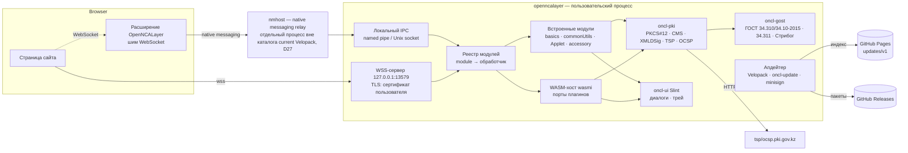
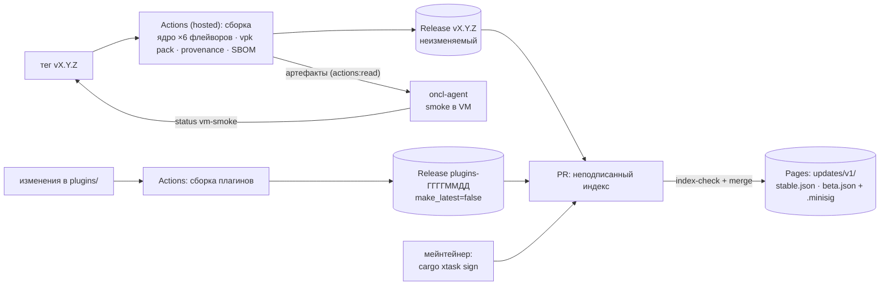
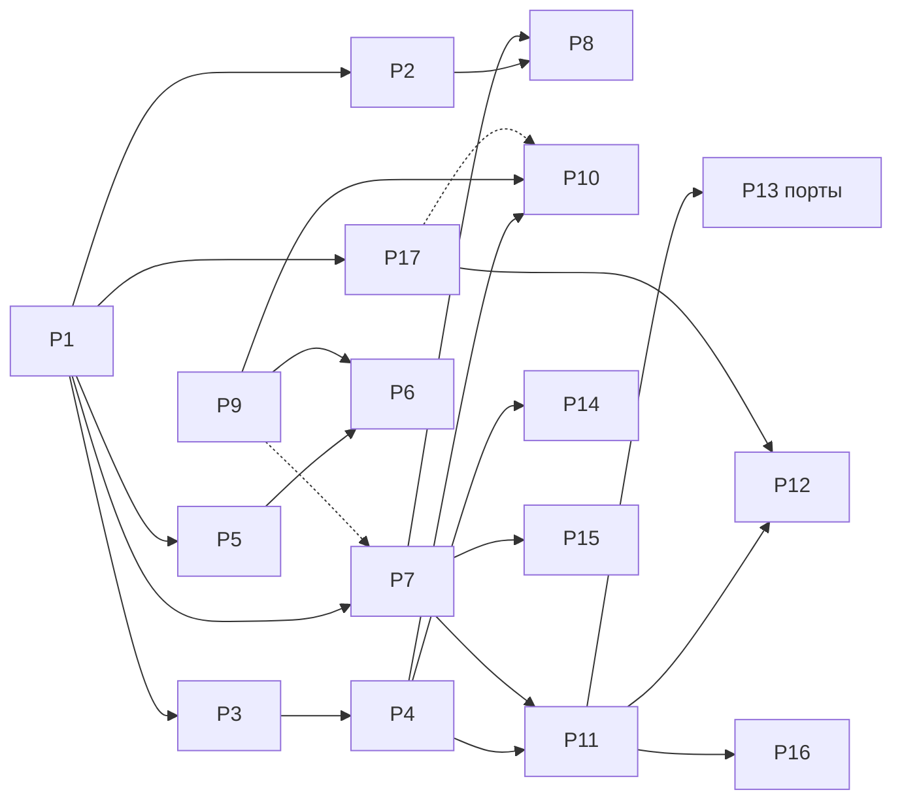

# OpenNCALayer — дизайн и дорожная карта

**Статус:** утверждено по итогам интервью 2026‑10‑24.

**Связанный документ:** `docs/original/architecture.md` — архитектура оригинального NCALayer.

Локальные заметки по реверс-инжинирингу оригинала не публикуются. Документы и код используют из них только факты: OID, константы, форматы.

## 1. Цель

OpenNCALayer — открытая замена NCALayer на Rust для личного и публичного использования. Сайты (egov.kz, госзакупки, банки, ЭДО), которые сегодня работают с оригиналом через `wss://127.0.0.1:13579`, должны работать без изменений:
- в том же протоколе;
- с теми же модулями;
- с портами сторонних плагинов.

## 2. Решения

| # | Тема | Решение |
|---|---|---|
| D1 | Язык | Rust; Java не используется |
| D2 | Имя | Продукт **OpenNCALayer**. Бинарь `openncalayer` (`openncalayer.exe`, никогда не `NCALayer.exe`). Префикс крейтов `oncl-`. Репозиторий `arynyklas/open-ncalayer` |
| D3 | Лицензия | **Apache-2.0** на весь репозиторий. Slint используется по Royalty-free 2.0 с атрибуцией `AboutSlint` |
| D4 | Транспорт | **wss://127.0.0.1:13579** с TLS-сертификатом пользователя. Источники сертификата: 1. Мастер генерирует локальный CA с name constraints (127.0.0.1, ::1, localhost) и leaf ≤ 800 дней, после чего ключ CA уничтожается. Перевыпуск = новый CA и повторная установка (по кнопке D5 или вручную). 2. Leaf от CA, уже установленного у пользователя: mkcert CAROOT или свой cert+key. С согласия пользователя OpenNCALayer **читает ключ этого CA**, выпускает leaf и перевыпускает его до истечения; сам ключ CA не копирует. 3. Готовый leaf с цепочкой. Проверка доверия только читает хранилища. Plain `ws://` **не делаем** |
| D5 | Установка сертификатов | OpenNCALayer **никогда не ставит сертификаты сам**. Исключение — явная кнопка с подтверждением: «Установить мой CA» или «Скачать и установить корни НУЦ» (с проверкой зашитых SHA-256). Ставит в хранилище текущего пользователя: Windows `CurrentUser\Root`, macOS login keychain, Linux — NSS-базы выбранных профилей. Рядом есть кнопка «Удалить». Ни установщик, ни автозапуск ничего не ставят |
| D6 | Расширение браузера | Делаем сразу после первого среза: Chromium MV3 и Firefox MV2, подменяют `WebSocket` к 127.0.0.1:13579–13679 и ходят в native messaging к хосту `io.github.arynyklas.openncalayer`. Если наш хост не установлен — прозрачно пропускают к оригиналу. Id расширения закреплены: Firefox `openncalayer@arynyklas.github.io`, Chromium — по ключу в манифесте (`oncl_ipc::ids`). Пока Firefox — AMO unlisted (шаг `web-ext sign` в CI только на тегах `v*`, при секретах AMO), Chromium — dev-mode; CWS и Edge позже |
| D7 | Безопасность протокола | **Точь-в-точь как оригинал**: без согласия по origin и без allowlist. Origin передаётся модулям в `addInfo` (в расширении — из `sender.origin`) |
| D8 | Плагины | **WASM** на wasmi 2.x с capability API: ключи, подпись, диалоги, HTTP по allowlist, файлы через диалоги. Встроенные модули оригинала (basics, commonUtils, Applet, accessory) сначала нативный Rust в ядре; после P11 переносятся в WASM (P16), чтобы правки протокола выходили без релиза ядра. Порты 40 сторонних модулей **пишем сами**, пока вендоры не начнут делать свои |
| D9 | Порядок портов | По охвату: 1. Встроенные модули. 2. Семейство ecc.kz. 3. Клоны commonUtils. 4. Семейство CommonInvoker. 5. Прочие средние. 6. Тяжёлые |
| D10 | Обновления | Подписанный **индекс** + неизменяемое хранилище файлов: - индекс `updates/v1/{stable,beta}.json` + `.minisig` на GitHub Pages: версии ядра по флейворам (`win-x64`, `win-x86`, `win7-x64`, `win7-x86`, `osx`, `linux-x64`), плагины, расширение, процент раскатки, отозванные версии, монотонный `seq`; - файлы — неизменяемые GitHub Releases: ядро `vX.Y.Z` (Latest), плагины пачками `plugins-ГГГГММДД[.N]` с `make_latest=false`; клиент в GitHub API не ходит; - ядро обновляет **Velopack** (крейт `velopack`): установка, zstd-дельты цепочкой с откатом на полный пакет, подмена `current`, перезапуск; свой `UpdateSource` читает индекс и проверяет minisign, `seq` и sha256; - плагины обновляются отдельно и перезагружаются без перезапуска ядра; - версия, которая запустилась, но не прошла health-check (сервер, UI), сама откатывается на предыдущую из индекса (`AllowVersionDowngrade`); от падения на старте защищают beta, раскатка, VM-smoke и откат после двух упавших подряд запусков; - индекс действует 30 дней с `generated` и не дольше `expires`: подменой старого индекса обновления замораживаются не дольше этого срока, полную защиту даст TUF (P15) |
| D11 | Подпись кода | Аккаунтов пока нет. Шаги CI (Authenticode через SignPath, Apple notarization через параметры подписи vpk, публикация в CWS/Edge) заложены и включаются секретами. Независимо от этого каждый релиз несёт build provenance (`actions/attest-build-provenance`) и SBOM |
| D12 | Установка | Per-user без прав администратора, через Velopack: - Windows: `Setup.exe` в `%LOCALAPPDATA%\OpenNCALayer` (stub + `current`), отдельные установщики win и win7 (RID `win10-*`/`win7-*`, установщик сам проверяет ОС). Хуки установки и удаления: HKCU Run, NM-манифесты, отключение автозапуска оригинала (D13); - macOS: universal `.app` в `.pkg` и `.zip`, LaunchAgent из хука; - Linux: AppImage с самообновлением, сборка в контейнере с glibc 2.28; AUR `openncalayer-bin` обновляет CI-бот, самообновление в нём выключено; deb/rpm — позже вместе с APT/RPM-репозиторием; - данные пользователя отдельно от установки и переживают удаление: `%APPDATA%\OpenNCALayer`, `~/Library/Application Support/OpenNCALayer`, `${XDG_DATA_HOME:-~/.local/share}/openncalayer`; - MSI per-machine — позже |
| D13 | Сосуществование | Замена: при установке **отключаем автозапуск оригинала, не удаляя его** (Startup `.lnk`, HKLM Run, `~/.config/autostart`). В настройках есть «Вернуть оригинал». Если порт занят оригиналом — предлагаем его остановить. Уточнено в P5: ярлыки Startup переносятся в `<данные>/original-autostart/`, `ncalayer.desktop` получает `Hidden=true` (с копией там же); журнал `original-autostart.json` пишется до каждого изменения, поэтому прерванное отключение или возврат доводится повторным вызовом. HKLM Run (64- и 32-битное представление реестра) только показывается: без прав администратора его не отключить, окно даёт инструкцию. Остановка оригинала — только по пункту трея с подтверждением, PID перепроверяется (тот же путь и время запуска) перед завершением. Демон, запущенный relay расширения, освободившийся порт сам не занимает — только после действия пользователя |
| D14 | Платформы | Linux (Debian/Ubuntu/Arch/Fedora; X11 и Wayland), macOS (x86_64 + arm64), Windows 10/11 x64/x86, **Windows 7 SP1 x64/x86 — первоклассно**: - отдельная сборка на закреплённом nightly с `-Zbuild-std` для `*-win7-windows-msvc`; - CI-гейт импортов (без Win8+ API; `combase.dll` и `api-ms-win-core-winrt-error-l1-1-0.dll` — только свои app-local DLL рядом с exe); - smoke-тест в Win7 VM |
| D15 | UI | Slint, software renderer. Трей — `tray-icon` + `muda` (`ksni` на Linux). Файлы — `rfd` |
| D16 | Хранилища ключей | PKCS#12 сразу. PC/SC-драйверы токенов (Kaztoken, удостоверение личности, eToken, JaCarta, AKey) — последней фазой, экспериментально, на эмуляторе: железа нет |
| D17 | Эталоны | Оригинальный NCALayer запускаем **только** в изолированных VM лаборатории; снятые транскрипты хранятся локально и не публикуются. В репозиторий идут только наши фикстуры: синтетический тестовый PKI и публичные сертификаты НУЦ |
| D18 | Лаборатория | Изолированная лаборатория из VM: Linux, Windows 7 x86, Windows 7 x64, Windows 11 и всегда включённая VM агента `oncl-agent` (D19). Сеть лаборатории изолирована: VM не видят локальную сеть, выход — только в интернет. Тестовые VM по умолчанию выключены и перед каждым прогоном откатываются к снапшоту. Инфраструктура лаборатории приватная |
| D19 | Гейт релиза | **Агент `oncl-agent` в лаборатории (pull), self-hosted runner не используется**: 1. Опрашивает GitHub токеном с правом `actions:read` и забирает артефакты сборки тега. 2. Откатывает тестовые VM к снапшоту узким токеном гипервизора (только откат снапшотов и питание, только VM лаборатории); тестовые VM этот токен не видят. 3. Гоняет smoke по WinRM/SSH: Win7 x86/x64, Win11, Linux. 4. Ставит commit status `vm-smoke` на коммит тега токеном с единственным правом `statuses:write`. Сценарий smoke — часть агента и обновляется мейнтейнером; из репозитория агент берёт только артефакты сборки |
| D20 | Реестр плагинов | GitHub Pages на **Zola** (ru/kk/en). Данные — TOML на каждый плагин. Изменения плагинов оригинала приходят от наблюдателя D28 (issue `upstream-plugin`, данные ветки `upstream`) |
| D21 | `installBundle` | `accessory.installBundle{symname}` сопоставляется с нашим портом: при наличии — диалог подтверждения и установка, иначе `BUNDLE_NOT_FOUND_OR_ALREADY_INSTALLED` и подсказка в трее со ссылкой на реестр |
| D22 | Документы | Документация на русском (README на RU и EN), код, идентификаторы и коммиты — на английском |
| D23 | Рабочий процесс | Реализация всегда в git worktree. Бинарники и артефакты — только в git-ignored каталогах. Пока ничего не пушим |
| D24 | Каналы | `stable` и `beta`. Новое сначала выходит предварительными версиями, а они идут только в beta (в том числе Win7-сборки и новые порты); релиз попадает и в stable, и в beta. Процент раскатки задаёт индекс, а какой установке версия достанется раньше, решает бакет `sha256(install_id‖version)` (не `staged_user_id` Velopack). Сломанная версия отзывается правкой индекса: её перестают предлагать, а клиенты, уже стоящие на ней, получают последнюю неотозванную (downgrade разрешён только с отозванной версии) |
| D25 | Версии | Ядро — semver `vX.Y.Z` по тегу; расширение — та же версия. Плагин — свой semver плюс `replaces {symname, version}` оригинала (показывается в реестре). Changelog — из conventional commits |
| D26 | Подпись индекса | minisign (ed25519), ключ **офлайн** у мейнтейнера (на зашифрованном носителе, позже YubiKey/TUF). В клиенте зашиты два открытых ключа: текущий и следующий для ротации. Подпись через PR: CI открывает PR с неподписанным индексом, мейнтейнер локально запускает `cargo xtask sign` и пушит `.minisig`. Обязательная проверка `index-check`: подпись валидна, `seq` растёт, для каждой новой версии ядра на её теге есть `vm-smoke = success`. После merge индекс уходит на Pages |
| D27 | NM-хост | Native messaging манифест хоста `io.github.arynyklas.openncalayer` указывает на маленький relay `nmhost` **вне каталога, который заменяет Velopack**: `%LOCALAPPDATA%\OpenNCALayer\nmhost.exe`; на macOS и Linux — `nmhost` в каталоге данных пользователя. Рядом — `nmhost.json` с абсолютными путями каталога данных и демона. Relay только пересылает сообщения в демон по локальному IPC (named pipe / Unix socket) и при необходимости запускает его (`run --allow-no-wss`). Relay заменяется переименованием, без ожидания: новый файл пишется в `nmhost.exe.new`, запущенный старый переименовывается в `nmhost.old-<unix-ms>.exe` (Windows; на Unix — атомарный `rename` поверх), `.new` становится `nmhost.exe`. Запущенные экземпляры дорабатывают со старым файлом; остатки `nmhost.old-*` удаляются при следующей установке, если не заняты. Ни stub Velopack, ни путь внутри `current` в манифест не попадают |
| D28 | Наблюдатель за оригиналом | Один наблюдатель на ядро и плагины (их публикует один манифест `ncalayer.der`). Код — `cargo xtask upstream` в публичном репо. Запуск каждые 6 ч и сырые данные (декомпилированный код, оригинальные файлы) — в **приватном** репозитории мейнтейнера. Публично — только факты (версия, размеры, sha256, бандлы, сертификаты, URL, имена модулей/классов/методов, коды ошибок) в orphan-ветке `upstream` и issues `upstream` / `upstream-plugin` / `upstream-alert` с дедупликацией по ключу. Оригинал не запускается, только распаковывается и разбирается |

## 3. Архитектура OpenNCALayer

### 3.1 Крейты

| Крейт | Ответственность |
|---|---|
| `oncl-gost` | Кривые (PKIGOVKZ‑A = CryptoPro‑A; TC26‑512‑A), подпись и проверка ГОСТ 34.10 в KZ-кодировке (`r_LE‖s_LE`, `X_LE‖Y_LE`). Хеши: 34.311 = `gost94::Gost94Test`; Стрибог |
| `oncl-pki` | BER→DER, PKCS#12, PKCS#8 (GOST/RSA), разбор сертификатов и KZ-атрибутов, CMS (подпись, со-подпись, проверка), TSP; позднее OCSP/PKIX/XMLDSig |
| `oncl-protocol` | Конверт NCALayer (приветствие, heartbeat, маршрутизация, `MODULE_NOT_FOUND`), диалекты ответов, семантика `CommonInvoker` |
| `oncl-basics` | Модуль `kz.gov.pki.knca.basics` и трейт `Prompter` (UI-абстракция) |
| `oncl-tls` | Мастер локального CA и leaf, импорт своего cert, файлы TLS, инструкции |
| `oncl-ui` | Slint-диалоги, реализующие `Prompter`; позже трей и настройки |
| `oncl-update` | Формат индекса обновлений, проверка minisign и `seq`, раскатка и отзыв, `UpdateSource` для Velopack, обновление плагинов |
| `openncalayer` | Бинарь: CLI, WSS/HTTP-сервер, пути, настройки, логи, сборка всего вместе |
| `xtask` | Генерация и скачивание фикстур, проверка импортов PE, сборка индекса и `sign`, сайт, лаборатория |

### 3.2 Модель плагинов

Плагин — архив из двух частей:
- `plugin.wasm` (`wasm32-unknown-unknown`);
- `plugin.toml`: id, версия, список `module`-имён, `replaces` = symname оригинала и версия, capabilities, минимальная версия ядра.

Целостность плагина обеспечивает sha256 в подписанном индексе (D10, D26); вендорские подписи появятся вместе с TUF-делегированием (P15).

ABI — core-wasm без WASI: CBOR в линейной памяти, импорт хост-функций по capability. Хост:
- регистрирует `module`-имена плагина в общем реестре (первый зарегистрировавший побеждает, как в оригинале);
- вызывает `process(request, addInfo)`.

SDK `oncl-pdk` (Rust) скрывает ABI. Порт оригинального модуля отвечает байт-в-байт тем же JSON-форматом, что и оригинал: четыре конвенции (`CommonInvoker` v2, рефлексия, свой switch, одна операция).

### 3.3 Релизы и обновления

Клиент:
1. Через 2–10 минут после запуска, а дальше раз в 6–24 часа (время выбирается случайно) скачивает индекс своего канала с Pages.
2. Проверяет подпись одним из двух зашитых ключей; отвергает индекс, если `seq` меньше последнего принятого или индексу больше 30 дней.
3. Ядро: строит из индекса фид для своего флейвора с учётом раскатки и отзыва и отдаёт его Velopack; Velopack качает дельты или полный пакет (sha256 проверяется), применяет и перезапускает, когда нет активной сессии или диалога.
4. Плагины: качает изменившиеся `.wasm`, сверяет sha256 и перезагружает модуль без перезапуска ядра.
5. После обновления ядра проверяет здоровье (сервер, UI); при провале откатывается на предыдущую версию из индекса.

## 4. Планы (фазы)

| План | Содержание | Зависит от |
|---|---|---|
| **P1** Сквозной срез | Workspace и CI; ГОСТ; PKCS#12; CMS с TSP; протокол; basics.sign (cms/raw); CLI-мастер TLS; WSS; Slint-диалоги; демо-страница с ncalayer-js-client; canary Win7 | — |
| P2 Расширение и native messaging | Шим WebSocket (MV3/MV2), relay `nmhost` вне `current` с IPC к демону (D27), переподключение при перезапуске демона, чанкинг ответов >1 МБ, сквозной проход к оригиналу, регистрация NM-хостов | P1 |
| P3 Валидация | Встроенные корни НУЦ (10 CA промышленной PKI, `oncl-pki::roots`), PKIX по RFC 5280 §6.1 без политик и name constraints (одноимённые CA выбираются по подписи, якорь — самоподписанный или верхний CA набора), OCSP (GET-биндинг, SHA-1 `CertID`, ответчик `byName`/`byKey` с `ocsp-nocheck`; отключает ключ только `revoked`), CRL для промежуточных CA в `cms-verify` (кэш, без delta CRL), семантика `chain`/`allowRevoked` в `basics.sign`, окно с причинами и датой отзыва, `cms-verify` с цепочками, отзывом и `INDETERMINATE` | P1 |
| P4 Протокол полностью | XMLDSig в форме Kalkan (`oncl-pki::xmldsig`: весь документ и элемент по подмножеству XPath, ГОСТ 2015-512/2004 и sha256RSA, байты документа сохраняются, разбор ограничен, без DOCTYPE; подписи принимает NCANode/Kalkan), basics `xml`/`generateCsr`/`importCertificate` (ключи ГОСТ 2015-512/2004 и sha256RSA 2048/3072/4096 бит, файлы PKCS#12 в профиле Kalkan, CSR с KeyStoreInfo; NCANode открывает наши файлы ключей), commonUtils (`oncl-commonutils`), подмножество Applet для файловых хранилищ (`oncl-applet`), accessory (`oncl-accessory`; окна — P5, `installBundle` — P11), JKS только на чтение, токены до P14 отвечают как без устройств, сетевые (UNC) пути от страницы отклоняются и не подставляются в окна, не больше 16 ключей и 16 сертификатов за запрос | P1, P3 |
| P5 Рабочий стол | Трей (`oncl-ui::tray`: tray-icon/muda на Windows и macOS, StatusNotifierItem `ksni` на Linux — ждёт панель с StatusNotifierWatcher до минуты после старта) с меню «Настройки…», «Сертификат для браузера…», «Журнал», «О программе», «Выход» и состоянием «внимание» (TLS не настроен, сертификат истекает ≤ 60 дней, порт занят); `run --no-tray` и работа без трея. Настройки (`settings.json`: `locale`, `autostart`, `proxy` none/system/manual для TSP/OCSP/CRL, HTTP absolute-form, HTTPS `CONNECT`, Basic-авторизация, без SOCKS), наш автозапуск (HKCU Run, XDG autostart, LaunchAgent), блоки «Оригинальный NCALayer» и «Расширение браузера». GUI-мастер TLS: свой CA, mkcert с отзываемым согласием и автоперевыпуском за 30 дней только тем же CA mkcert, импорт; проверка доверия только чтением и живая проверка `/openncalayer/selftest`; кнопки «Установить мой CA в хранилище пользователя»/«Удалить» для своего CA и «Скачать и установить корни НУЦ»/«Удалить корни НУЦ» для `rcarsa20` и `ncarsa22` (D5, `oncl-trust`; удаляются ровно эти сертификаты по байтам); «Удалить старый» после перевыпуска. Напоминания при старте и раз в сутки. Сосуществование (D13, `oncl-desktop`): отключение и возврат автозапуска оригинала с журналом, определение владельца порта, «Остановить оригинал…» и запуск wss без перезапуска демона. «О программе» с AboutSlint, вкладками «Модули» и сторонних лицензий (`cargo xtask licenses`); accessory `showSettings`/`showBundleManager` открывают окна, `installBundle` — уведомление | P1 |
| P6 Win7 | Сборки `x86_64-win7-windows-msvc` и `i686-win7-windows-msvc` на закреплённом nightly (`-Zbuild-std=std,panic_abort`, `+crt-static` — без VC++ redist), `cargo xtask win7 [--arch x64\|x86\|all]` → `target/win7/<arch>/`. Рядом с exe — app-local `combase.dll` (форварды `CoTaskMemFree`, `CoCreateFreeThreadedMarshaler` в `ole32`) и `api-ms-win-core-winrt-error-l1-1-0.dll` (заглушки `RoOriginateError[W]`); на Win8+ их перекрывают KnownDLLs и наборы API. `SystemParametersInfoForDpi` ищется во время выполнения в изменённой копии `vendor/i-slint-backend-winit` (`[patch.crates-io]`, NOTICE). Гейт импортов блокирующий (job `win7` в CI на каждый push, x64 и x86): denylist Win8+ DLL и функций с учётом декорирования x86, app-local DLL принимаются, только если лежат рядом и экспортируют ровно нужное имя, `nmhost.exe` проверяется без них; затем запуск сборки на Windows (`/` по HTTPS, `nm status`). Релиз: `…-win7-x64.zip`, `…-win7-x86.zip`, `…-i686-pc-windows-msvc.zip`, пакеты Velopack флейворов `win7-x64` и `win7-x86`, содержимое которых (вместе с `Squirrel.exe` и заглушкой Velopack) проходит тот же гейт. Расширение в Firefox ESR 115 (шим через Xray, `strict_min_version` 115), e2e в ESR 115. Allowlist по экспортам Win7 SP1 и smoke в VM Win7 — ⏳ до P9 | P1, P5, P9 |
| P7 Апдейтер и релизы | `oncl-update`: индекс `updates/v1/<канал>.json` схемы 1, подпись minisign в режиме prehashed с доверенным комментарием `channel=…;seq=…`, два зашитых открытых ключа (`crates/oncl-update/keys/{current,next}.pub`, встраиваются при сборке), лимит 1 МиБ, отказ при `seq` назад, чужом канале и возрасте больше 30 дней; выбор версии с раскаткой по бакету `sha256(install_id‖version)`, отзывом и даунгрейдом только с отозванной версии (D24); состояние в `<данные>/update/state.json`. В демоне — `velopack` с фидом из индекса (sha256 и размер пакета сверяются до установки, скачивание по HTTPS через прокси настроек), проверка через 2–10 минут после старта и раз в 6–24 часа, установка в простое (нет запросов и окон), health-check (5 с работы подтверждают версию, 60 с на запуск, два сбойных запуска подряд — откат, не больше трёх попыток), настройки `updates` в окне и пункт в меню значка. `cargo xtask sign keygen|sign` и `index add|refresh|check`; workflow `release.yml` (флейворы `win-x64`, `win-x86`, `win7-x64`, `win7-x86`, `linux-x64`, `osx`; `vpk pack` с дельтами, provenance, SBOM, шаги подписи кода по секретам, PR с неподписанными индексами: пререлиз — в beta, релиз — в stable и beta), `index-check.yml`, `pages.yml`. Установщики — P8 | P1 (гейт `vm-smoke` включается с P9) |
| P8 Установщики | vpk: `Setup.exe` win/win7 x64/x86 с хуками (HKCU Run, NM-манифесты и раскладка `nmhost` по D27, отключение оригинала), macOS `.pkg`/`.zip` + LaunchAgent, Linux AppImage (контейнер glibc 2.28), AUR `-bin` с CI-ботом | P2, P7 |
| P9 Лаборатория | Изолированная лаборатория по D18 (инфраструктура приватная): 5 VM, агент `oncl-agent` (D19), рекордер эталонов оригинала, VM-smoke. Нужны от мейнтейнера: образы Windows и их активация | — (параллельно) |
| P10 Conformance | Транскрипты оригинала → тесты; устранение расхождений | P4, P9 |
| P11 Плагины | wasmi-хост, capability API, `oncl-pdk`, формат плагинов, загрузка и горячее обновление по индексу, менеджер плагинов, `installBundle` (D21) | P4, P7 |
| P12 Реестр | Zola-сайт (тот же деплой Pages, что и `updates/v1`), данные плагинов, страница загрузки, страница «История оригинала» из ветки `upstream` (D28) | P11, P17 |
| P13.1–6 Порты | Группы по D9 | P11 |
| P14 Токены | PC/SC-драйверы и эмулятор, experimental | P4 |
| P15 TUF | Миграция индекса с minisign на TUF, делегирование вендорам | P7 |
| P16 Встроенные модули → WASM | basics, commonUtils, Applet, accessory переезжают в WASM-модули; ядро остаётся транспортом, криптографией, UI и обновлениями | P11 |
| P17 Наблюдатель за оригиналом | `cargo xtask upstream` (манифест с проверкой ГОСТ-подписи, опрос источников, распаковка, факты из байткода и keystore, diff, issues), workflow приватного репо, ветка `upstream`, декомпиляция изменённых JAR | P1 |

## 5. Внешние аккаунты (будущее)

- Chrome Web Store ($5) и Google Cloud-проект для CI-публикации.
- Edge Partner Center.
- Mozilla AMO (уже для unlisted-подписи).
- SignPath Foundation.
- Apple Developer.
- Регистрация в SDK НУЦ: нужен мейнтейнер с ЭЦП. Запрос в knca@pki.gov.kz о праве распространять тестовые ключи.
- YubiKey ×3–5 для TUF (P15).
- AUR-аккаунт и SSH-ключ для бота, обновляющего `openncalayer-bin`.
- Приватный репозиторий и GitHub App мейнтейнера для наблюдателя (P17, D28).

## 6. Главные риски

| Риск | Мера |
|---|---|
| Win7 ломается от свежих крейтов (`combase.dll`, Win8+ API) | Отдельная сборка, гейт импортов, smoke в VM (P6, P9) |
| KZ-квирки: порядок байт ГОСТ, BER-CMS от Kalkan, PBES2 с PRF по умолчанию SHA‑256 | Тесты на реальных сертификатах НУЦ и фикстурах NCANode, сверка с эталонами (P10) |
| Без установленного CA wss не работает | Мастер TLS (P1/P5) и расширение (P2) |
| Сайты меняют поведение оригинала (например, новые модули) | Наблюдатель за оригиналом (P17, D28), conformance (P10) |
| НУЦ блокирует доступ к своим сайтам с IP GitHub | Проба доступности до начала P17; при блокировке опрос переезжает на `oncl-agent` в лаборатории |
| Velopack — внешняя зависимость: тянет `windows` 0.62 (на Win7 нужен ole32-форвардер) и `ureq` 3 с TLS по умолчанию, vpk требует .NET в CI | Форвардер и гейт импортов из P6 закрывают и Velopack; запрет `aws-lc-*` в `deny.toml` проверяет TLS-бэкенд; vpk — только в CI |
| Velopack при обновлении заменяет `current` и убивает процессы из него — NM-хосты, запущенные браузером, умерли бы посреди подписи | NM-манифест указывает на отдельный relay **вне** `current` (D27) |
| Подписанный индекс можно подменять старым, пока он действителен: при компрометации Pages можно ненадолго «заморозить» обновления | Подпись не подделать без офлайн-ключа; индекс действует не дольше 30 дней с `generated` (и не после `expires`), `seq` не идёт назад; полностью заморозку закрывает TUF (P15) |
