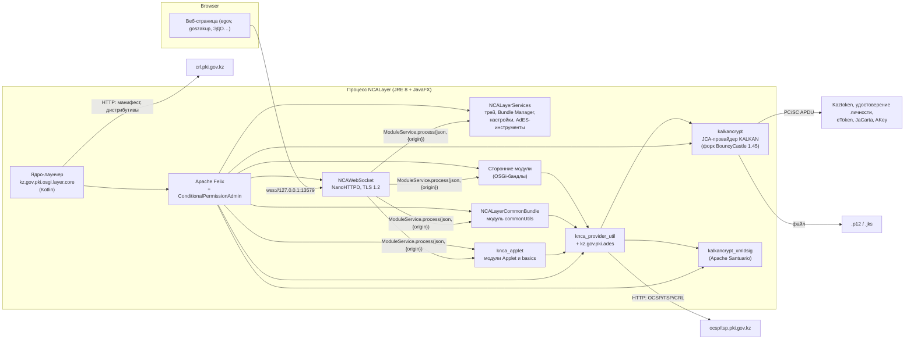
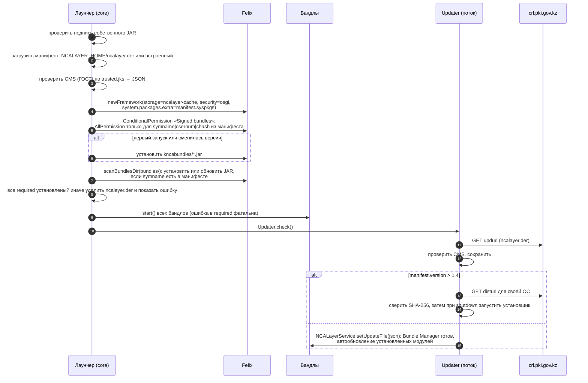

# Архитектура оригинального NCALayer (NITEC / НУЦ РК)

Документ описывает, как устроен закрытый NCALayer версии ядра **1.4**. Это справка для open-ncalayer — открытой реализации на Rust.

**Источник.** Документ основан на статическом анализе дистрибутивов, полученных 2026‑10‑24:

| Дистрибутив | Что содержит |
|---|---|
| Linux zip (`ncalayer.sh`) | Bash-установщик и JAR в одном файле |
| `NCALayerInstall_x64.exe` / x86 | Inno Setup 6.5.2 |
| Корпоративный MSI | WiX 3.14 |
| `ncalayerlite.exe` | Загрузчик на Go |
| macOS DMG | Пакет приложения |
| Живой манифест `http://crl.pki.gov.kz/updates/ncalayer.der` | Список бандлов и ссылки на дистрибутивы |

**Ограничения.**
- Оригинальные бинарники не запускались. Выводы получены декомпиляцией (Vineflower), из байткода (`javap`) и разбором ресурсов и ASN.1. Где поведение выведено, а не прочитано в коде, стоит пометка *(вывод)*.
- Исходный код оригинала в этот репозиторий не копировался.
- Рабочие материалы (декомпиляция, отчёты по срезам) хранятся локально и не публикуются.

---

## 1. Общая картина

NCALayer — это фоновое Java 8-приложение пользователя. Оно поднимает **TLS WebSocket на `127.0.0.1:13579`** и выполняет запросы веб-страниц:
- подпись CMS/XML/raw;
- выбор ключа;
- работу с токенами;
- генерацию CSR.

Внутри работает **OSGi-фреймворк Apache Felix**. Вся функциональность разложена по подписанным бандлам (JAR). Сторонние вендоры (госзакупки, ЭСФ, банки, ЭДО) расширяют API своими бандлами-«модулями». Каталог модулей приходит в **подписанном ГОСТ-манифесте**.



---

## 2. Состав поставки

### 2.1 Ядро-лаунчер (единый «fat JAR»)

**Main-Class** — `kz.gov.pki.osgi.layer.core.NCALayer` (Kotlin), `Implementation-Version: 1.4`.

В этот же JAR упакованы:
- Apache Felix Framework вместе с Felix Log и Security;
- Kotlin stdlib;
- logback, slf4j;
- commons-compress;
- org.json;
- полная копия классов kalkancrypt (`kz/gov/pki/kalkan/**`) для проверки манифеста.

Ресурсы:

| Ресурс | Назначение |
|---|---|
| `trusted.jks` | Сертификаты, которым доверяет проверка подписи манифеста (ГОСТ-сертификаты подписантов NCALayer) |
| `ncalayer.der` | Встроенная копия подписанного манифеста |
| `all.policy` | `grant { AllPermission }` для системного бандла |
| `kncabundles/*.jar` | 7 обязательных бандлов |
| `logback.xml` | Конфигурация логирования |

Сам JAR подписан, подпись `META-INF/CS_KNCA.*`. Если `Implementation-Version` задан, а подписи нет, ядро отказывается стартовать с ошибкой «Core is unsigned!».

### 2.2 Обязательные бандлы (живой манифест, 2026‑10)

| Symbolic name | Версия | Роль |
|---|---|---|
| `kz.gov.pki.kalkan.knca_provider_jce_kalkan` | 0.7.8 | JCA-провайдер **KALKAN**: ГОСТ 34.310/34.311/34.10‑2015, RSA, PKCS#12, CMS, TSP, OCSP, PC/SC-драйверы токенов |
| `kz.gov.pki.kalkan.xmldsig` | 0.5.2 | XMLDSig на Apache Santuario 3.0.2 с URI алгоритмов РК |
| `kz.gov.pki.provider.knca_provider_util` | 0.9.2 | Высокоуровневые утилиты: `KeyStoreUtil`, `CMSUtil`, `XMLUtil`, `PKIXUtil`, TSP/OCSP. С 0.9 добавлен AdES-движок `kz.gov.pki.ades` (CAdES/XAdES/PAdES B/T/LT/LTA). Встроенные корни НУЦ: `cacerts.jks`, тестовые в `cacerts_test.jks` |
| `kz.gov.pki.api.layer.NCALayerServices` | 0.8.3 | Трей, Bundle Manager, настройки (прокси, язык), «О программе». С 0.8 добавлены Keystore Explorer, AdES-подпись и проверка. Также экспортирует SDK для плагинов (`CommonInvoker`, аннотации) |
| `kz.gov.pki.knca.applet.knca_applet` | 0.4.13 | Модули `kz.gov.pki.knca.applet.Applet` (наследие Java-апплета) и `kz.gov.pki.knca.basics` (современный API, JavaFX-диалоги) |
| `kz.gov.pki.osgi.layer.websocket` | 0.4.3 | WebSocket-сервер и маршрутизация к модулям. С 0.4.3 добавлены статические страницы `/` и `/basics/` |
| `kz.gov.pki.osgi.layer.common` | 0.3.4 | Модуль `kz.gov.pki.knca.commonUtils` со Swing-диалогами |

В Linux zip лежат более старые версии (Services 0.7.4, WS 0.4.2, applet 0.4.10, util 0.8.8, xmldsig 0.4); Windows-установщик находится посередине. Протокольная поверхность у всех версий одинакова.

### 2.3 Состояние пользователя (`NCALAYER_HOME`)

| ОС | Путь |
|---|---|
| Windows | `%APPDATA%\NCALayer` |
| macOS | `~/Library/Application Support/NCALayer` |
| Linux | `~/.config/NCALayer` |
| Прочие | Не поддерживаются: исключение в статической инициализации |

Содержимое каталога:

| Файл | Назначение |
|---|---|
| `ncalayer.der` | Последний проверенный манифест |
| `bundles/` | Скачанные модули, имя `<symname>_<version>_<uuid>.jar`. Каталог никогда не чистится |
| `ncalayer-cache/` | Кэш Felix |
| `settings.json` | Язык, прокси (пароль лишь обфусцирован), `recentPath` |
| `ncalayer.log` | Лог, ротация 1 МБ × 3 |

---

## 3. Жизненный цикл процесса



**Единственный экземпляр.** Отдельного механизма нет: ни mutex, ни lock-файла. Второй процесс просто не может занять порт 13579, показывает иконку ошибки и продолжает висеть.

**Утилиты Linux.** `showBundleManager` и `showSettings` — это Go-программы. Каждая открывает `wss://127.0.0.1:13579/` без проверки сертификата и отправляет команду модулю `kz.gov.pki.ncalayerservices.accessory`.

---

## 4. Модель доверия и обновлений

### 4.1 Манифест (`ncalayer.der`)

Манифест — это CMS SignedData с JSON внутри. Подпись ГОСТ 2015‑512 / Стрибог‑512, подписант — сертификат `CN=NCALayer` от «ҰЛТТЫҚ КУӘЛАНДЫРУШЫ ОРТАЛЫҚ (GOST) 2022». Встречались два серийных номера подписанта, оба есть в `trusted.jks`.

Схема JSON:

```text
{ "ncalayer": {
    "version": "1.4",            // версия ядра; если больше текущей, это обновление ядра
    "info": "…",                 // текст для диалога обновления
    "updurl": "http://crl.pki.gov.kz/updates/ncalayer.der",
    "syspkgs": "javafx.…,kz.gov.pki.osgi.layer.api,org.json,…",   // OSGi system.packages.extra
    "disturls": [ { "type": "setupexe|setupsh|appzip|jar|jresetupexe", "url": "…", "hash": "<sha256 hex>" } ],
    "bundles":  [ { "name", "symname", "version", "required"?, "hidden"?, "banned"?,
                    "info", "url", "hash": "<sha256(jar)>",
                    "csernum": "<hex(BigInteger.toByteArray(serial))>",
                    "chash": "<sha256(signer cert DER)>" } ] } }
```

Живой манифест содержит **47 записей**: 7 обязательных и **40 сторонних модулей**.

### 4.2 Допуск кода

- **Felix.** Включён `org.osgi.framework.security=osgi`. `CertCondition` даёт бандлу `AllPermission` только при одном условии: строка `symname|serial|sha256(cert)` его единственного подписанта совпадает с записью в манифесте. Иначе бандл деинсталлируется.
- **Срок действия.** Срок и цепочка сертификата подписи кода не проверяются. Пиннинг идёт только по serial и хешу. На практике бандлы подписаны сертификатом Sectigo, истёкшим в 2024 году, а kalkancrypt — JCE-сертификатом Oracle, истёкшим в 2023 году.
- **Целостность загрузки.** Скачанный модуль проверяется по `hash`, то есть SHA‑256 файла. Все URL в манифесте — **plain HTTP**. Целостность держится только на CMS-подписи манифеста и SHA‑256.

### 4.3 Обновление модулей

1. В Bundle Manager пользователь сам ставит галочки. Альтернатива — страница вызывает `accessory.installBundle{symname}` и пользователь подтверждает.
2. JAR скачивается, сверяется SHA‑256 и сохраняется в `bundles/`.
3. NCALayer просит перезапуск.
4. При следующем старте работает `scanBundlesDir`, затем `CertCondition`.
5. Установленные модули, для которых в манифесте есть более новая версия, скачиваются автоматически, и снова предлагается перезапуск.

**Дефекты:**
- флаг `banned` разбирается, но нигде не применяется;
- удаление модуля не удаляет JAR, поэтому после рестарта модуль возвращается;
- старые версии JAR не удаляются.

### 4.4 Обновление ядра

Обновление ядра — это полный дистрибутив, без дельт:

| ОС | Что скачивается | Как применяется |
|---|---|---|
| Windows | `setupexe` (сейчас lite-загрузчик) | Запускается при выходе |
| Linux | `setupsh` | Копируется поверх себя, затем `--run` |
| macOS | `appzip` | Распаковывается поверх `.app`. Ссылка из манифеста отдаёт 404, перезапуск отсутствует |

Сейчас `version` = 1.4 = версия ядра, так что ветка обновления ядра спит.

---

## 5. Транспорт браузер ↔ NCALayer

### 5.1 Слушатель

- Ровно один слушатель: **TCP `127.0.0.1:13579`, только TLS 1.2**. Нет `ws://`, нет IPv6, нет fallback.
- Порт можно переопределить переменной `NCALAYERPORT` (13579–13679), но только в сессиях RDP/Citrix/xrdp.

### 5.2 Сертификат и доверие

- Серверный сертификат — `CN=127.0.0.1`, SAN `IP:127.0.0.1`, `DNS:localhost`, RSA‑2048, срок до 2027‑04‑03.
- Он выпущен «ҰЛТТЫҚ КУӘЛАНДЫРУШЫ ОРТАЛЫҚ (RSA) 2022», который подписан корнем «НЕГІЗГІ КУӘЛАНДЫРУШЫ ОРТАЛЫҚ (RSA)».
- **Закрытый ключ лежит в JKS внутри бандла под зашитым паролем.** Значит, ключ один на все установки и по сути публичен.
- Браузеры доверяют этому сертификату только потому, что NCALayer **устанавливает корни НУЦ в хранилища ОС и браузеров**:

| ОС | Кто устанавливает | Куда |
|---|---|---|
| Windows | Бандл WebSocket при каждом старте | `CurrentUser\ROOT` |
| macOS | Бандл WebSocket при каждом старте | Login keychain |
| Linux | `ncalayer.sh` через `certutil` | Все NSS-базы `cert8.db`/`cert9.db` под `~` |

- Корни НУЦ **не входят** в корневые программы Mozilla, Chrome, Apple и Microsoft.

### 5.3 Рукопожатие и прочее

- После апгрейда сервер сразу шлёт приветствие `{"result":{"version":"1.4"}}`.
- Текст `--heartbeat--` возвращается эхом. Только он сам: варианты (другой регистр, пробелы, `--heartbeat--` внутри JSON) — обычный текст.
- Idle-таймаут сокета — 20 минут.
- **Проверки Origin нет.** Origin только пробрасывается модулям в `addInfo`.
- Нет rate limit и нет согласия на сайт.
- Сообщения одного соединения обрабатываются последовательно, в синхронном потоке: второй запрос ждёт ответа на первый и получает ответ сразу после него. Разные соединения обрабатываются параллельно.
- Запрос читается как `new JSONObject(text)` org.json. Невалидный JSON, пустой текст, JSON не-объект (`[]`, `"s"`, `1`, `null`, `true`), BOM перед `{` и повтор ключа в любом объекте (`Duplicate key`) рвут соединение без close-фрейма и без ответа. Текст после первого объекта, в том числе второй объект, не читается: ответ — на первый объект.
- Кадр клиента без маски принимается как обычный. Кадры с нарушением RFC 6455 (RSV1 без расширения, зарезервированный opcode, продолжение без начала, текст не в UTF-8, управляющий кадр длиннее 125 байт) рвут соединение без close-фрейма; фрагменты собираются, на ping приходит pong, на close — close с тем же кодом.

---

## 6. Протокол модулей

### 6.1 Маршрутизация

- Модуль выбирается по полю `module`. По умолчанию — `kz.gov.pki.knca.applet.Applet`.
- Сервер ведёт реестр OSGi-сервисов `ModuleService { String process(String json, String addInfo) }` с свойством `module=<имя>`. Побеждает первая регистрация.
- В `addInfo` передаётся `{"origin": "<Origin>"}`.
- Неизвестный модуль даёт ответ `{"success":false,"errorCode":"MODULE_NOT_FOUND"}`.

Каждый модуль сам разбирает запрос, поэтому **диалектов ответа несколько**. Все сериализуются через org.json, и `null`-поля опускаются.

### 6.2 Встроенные модули

| `module` | Запрос | Ответ | Методы |
|---|---|---|---|
| `kz.gov.pki.knca.basics` | `{method, class?, apiVersion?:2, args:{…}}` | `{body, status:true}` / `{code, details?, message, status:false}` — ключи в этом порядке (`HashMap` org.json); отмена — `{body:{}, status:true}` | `PKIExtras.sign` (формат `cms`/`xml`/`raw`; фильтры `extKeyUsageOids`, `iin`, `bin`, `serialNumber`, `chain`; TSP; проверка OCSP), `PKIEssentials.generateCsr`, `PKIEssentials.importCertificate` |
| `kz.gov.pki.knca.commonUtils` | `{method, args:[…позиционные], uuid?}` | `{responseObject?, code:"200"\|"500", message?, uuid?}` — ключи в этом порядке (`HashMap` org.json), `uuid` только в ответе метода; отмена — `{code:"500", message:"action.canceled"}` | `getActiveTokens`, `getKeyInfo`, `signXml`, `signXmls`, `createCAdESFromBase64`, `createCAdESFromFile`, `createCAdESFromBase64Hash`, `applyCAdEST`, `createCMSSignatureFromBase64/File` (устар.), `showFileChooser`, `changeLocale` |
| `kz.gov.pki.knca.applet.Applet` | `{method, args:[…], uuid?}` | `{result?, errorCode:"NONE"\|<код>, secondResult?, uuid?}` (порядок `HashMap`); `getProvider` — таблица свойств провайдера без `errorCode` | `loadSlotList`, `browseKeyStore`, `showFileChooser`, `getPublicPartInfo`, `setPassword`, `getTryCount`, `genExt`, `genKeyPairAndGetPKCS10`, `setX509CertToKeyStore*`, `changePassword`, `signXml`, `deleteEntry`, `resetStorage`, `getProvider` |
| `kz.gov.pki.ncalayerservices.accessory` | `{method, symname?, uuid?}` | `{errorCode}` / объект | `getBundles`, `getServices`, `installBundle`, `showBundleManager`, `showSettings`, `showKeystoreExplorer`, `showAdesSigning`, `showAdesValidation` |

**Имена хранилищ** (точные строки): `PKCS12`, `JKS`, `AKKaztokenStore`, `AKKZIDCardStore`, `AKEToken72KStore`, `AKEToken5110Store`, `AKJaCartaStore`, `AKAKEYStore`, `ABCloudServiceStore` (объявлено, но не реализовано).

**Опасные вызовы без диалога:**

| Вызов | Что делает |
|---|---|
| `Applet.getPublicPartInfo` | Читает ИИН и ФИО с удостоверения личности |
| `Applet.resetStorage` | Форматирует eToken/JaCarta |
| `Applet.changePassword` | Меняет пароль; оба пароля передаёт страница |
| `commonUtils.createCAdESFromFile` | Читает файл по пути, заданному страницей |

Кроме того, в `Applet` пароль хранится в общем состоянии — одном на все соединения и сайты.

### 6.3 SDK для сторонних модулей

Модуль — это OSGi-бандл. Его активатор регистрирует один или несколько `ModuleService` со свойством `module`. Сторонние модули используют четыре конвенции:

1. **`CommonInvoker` v2.** Хост-класс из NCALayerServices, методы помечены `@NCALayerMethod`. Используется в 7 модулях; Everflow 1.16.5 принимает и этот формат, и прежний — одну операцию с именованными полями (`keyType`, `filePath`/`tokenName`, `filesNames`, `dataForSign`).
2. **Рефлексия «по образцу commonUtils».** Позиционные `args`; метод ищется через `getDeclaredMethods` по имени и числу аргументов. Приватные методы при этом находятся, но `setAccessible` никто не вызывает, поэтому их вызов завершается ошибкой доступа: со страницы доступны только публичные методы. Используется в 9 модулях.
3. **Собственный switch** по полю `method`, `type` или `command`. Например, семейство ecc.kz (`NURSign`, `K2Sign`, `MarketSign`, `EFactoringSign`) выбирает операцию по `type`, кабинет налогоплательщика КГД — по `command`.
4. **Одна операция** с позиционными `{uuid, args:[b64, fileNames]}` (2 модуля).

Чтобы сторонние модули работали, хост должен давать им:
- KALKAN-провайдер (`NCALayerService.getProvider`) и `knca_provider_util`: пакет `kz.gov.pki.provider.utils` импортируют 30 модулей, а `KeyStoreUtil.getDefaultCACerts` (напрямую или через `getSigningEntityDefaultChained`) нужен 8 из них;
- `javax.smartcardio`;
- JavaFX/Swing;
- файловую систему;
- исходящий HTTP (TSP, OCSP, сервера вендоров);
- org.json и slf4j.

Заголовка `Bundle-NativeCode` нет ни в одном модуле, но ezSigner 1.2.1 несёт JNA с 27 нативными сборками `jnidispatch` и через неё вызывает Windows API (`WNetGetConnection`, `GetDriveType`). Три модуля (Buhta, AC Bank, Documentolog) несут собственную полную копию kalkan, а AC Bank — ещё и Apache Felix.

Подсчёты сделаны по 34 из 40 сторонних модулей манифеста от 2026‑10‑28; JAR-файлы шести модулей недоступны.

---

## 7. Криптография (KALKAN)

| Что | Факт |
|---|---|
| Хеш ГОСТ 34.311‑95 | Это ГОСТ Р 34.11‑94 с **тестовым** S-блоком; байт-в-байт совпадает с `gost94::Gost94Test`. OID `1.2.398.3.10.1.3.1` |
| Стрибог | 256/512, OID `1.2.398.3.10.1.3.2` / `.3.3` |
| Подпись 34.310‑2004 | Кривая PKIGOVKZ‑A = CryptoPro‑A, OID ключа `1.2.398.3.10.1.1.1.1`, подписи `…1.1.1.2` |
| Подпись ГОСТ 2015 | 256 (TC26‑256‑A, кофактор 4) и **512 (TC26‑512‑A — текущие ключи НУЦ и удостоверения личности)**. OID подписи `1.2.398.3.10.1.1.2.3.1` / `.3.2` |
| Порядок байт РК | `e = LE(hash)`, подпись = `r_LE ‖ s_LE`, открытый ключ = `X_LE ‖ Y_LE` |
| RSA | PKCS#1 v1.5, SHA‑1/256 |
| PKCS#12 | Чтение: PBE `1.2.840.113549.1.12.1.*` (3DES, RC2‑40, RC4) и PBES2/AES‑256, причём **PRF по умолчанию SHA‑256** (нестандартно). Запись: 3DES для ключа, RC2‑40 для сертификатов, HMAC‑SHA1, 1024 итерации |
| CMS | Атрибуты contentType, signingTime, messageDigest, signingCertificateV2. В CMS кладётся только сертификат подписанта. Со-подпись — слиянием SignerInfo. Вывод — PEM `BEGIN CMS` (basics) или base64 DER (commonUtils) |
| TSP | `http://tsp.pki.gov.kz`, нестандартный GET-биндинг `<url>/<urlencoded base64>` с POST как fallback. В basics при наличии `tsaProfile` всегда используются Стрибог‑512 и политика `1.2.398.3.3.2.6.4` |
| OCSP / CRL | `http://ocsp.pki.gov.kz`, только HTTP. Доверие — встроенный `cacerts.jks` (10 prod-корней и промежуточных; тестовые 6 автоматически не грузятся) |
| XMLDSig | Inclusive C14N, трансформы enveloped и c14n‑with‑comments, сертификат в KeyInfo, подпись добавляется в корень. URI: `xmldsig-more#gost34310-gost34311`, `urn:ietf:params:xml:ns:pkigovkz:xmlsec:algorithms:gostr34102015-gostr34112015-512` и др. Модули возвращают документ без объявления XML, подпись — без переводов строк, base64 — одной строкой |
| Токены | **Только PC/SC APDU, без PKCS#11.** Тип токена определяется по точному ATR. Драйверы: Kaztoken, удостоверение личности РК (ГОСТ‑512 + RSA‑2048), eToken 72K, eToken 5110, JaCarta, AKey |
| AdES (0.9.x) | CAdES/XAdES/PAdES уровней B/T/LT/LTA, видимый штамп в PDF. Используется в UI-инструментах, **в WebSocket API не входит** |

---

## 8. Платформенная интеграция

| ОС | Установка | Автозапуск | Сертификаты | Прочее |
|---|---|---|---|---|
| Windows (Inno x64/x86) | `Program Files\NCALayer`, нужен администратор. Liberica JRE 8 с JavaFX, launch4j `NCALayer.exe` | `.lnk` в Startup | Ставит рантайм (`CurrentUser\ROOT`) | Переустановка тихо удаляет предыдущую версию **вместе с `%APPDATA%\NCALayer`**. `taskkill /IM NCALayer.exe` |
| Windows MSI | То же, per-machine | `HKLM\…\Run\NCALayer` | Рантайм | UpgradeCode совпадает с AppId Inno |
| Windows lite | `%APPDATA%\NCALayer\NCALayer.exe` без JRE | Нет | Рантайм | Загрузчик на Go |
| macOS | `NCALayer.app` (только x86_64), Liberica 8 | Нет | Рантайм (login keychain) | Подписано Developer ID, нотаризация не пристёплена |
| Linux | Каталог на выбор пользователя, `jre8_ncalayer`; XDG `.desktop` | `~/.config/autostart` | `certutil` во все NSS-базы | Требует X-сервер. `--stop` убивает любой `java -jar` |

---

## 9. Что OpenNCALayer наследует и что меняет

Решения зафиксированы в `docs/design/roadmap.md` (D1–D23); здесь краткая выжимка.

| Аспект | Оригинал | OpenNCALayer |
|---|---|---|
| Совместимость протокола | — | Сохраняются: имена модулей, диалекты ответов, коды ошибок, приветствие, heartbeat |
| Доверие TLS | Корни НУЦ ставятся в ОС и браузеры автоматически при каждом старте | Сертификат пользователя для `wss://127.0.0.1:13579` (свой локальный CA с name constraints, mkcert/свой CA или готовый leaf) и расширение браузера. Автоматически ничего не ставится; установка только по явной кнопке пользователя (D4–D6) |
| Безопасность протокола | Нет согласия на origin; опасные вызовы без UI; общий пароль | Как в оригинале (D7) |
| Плагины | OSGi JAR (Java), выполняются с AllPermission | WASM-порты с явными capability (D8) |
| Обновления | HTTP плюс CMS ГОСТ; полный дистрибутив; `banned` не работает | GitHub Releases, подпись minisign, модульные обновления и zstd-дельты (D10) |
| Рантайм | JRE 8 + JavaFX, 70–114 МБ | Один нативный бинарь на Rust |
